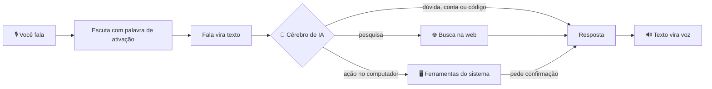

<div align="center">


# SEXTA-FEIRA

**Assistente virtual inteligente em Python, com voz, automações no PC e IA.**

Pergunte qualquer coisa, peça uma pesquisa e continue trabalhando: ela avisa falando quando terminar.


[Sobre](#-sobre) • [Funcionalidades](#-funcionalidades) • [Como funciona](#-como-funciona) • [Instalação](#-instalação-e-execução) • [Roadmap](#-roadmap)

</div>

---

## 📖 Sobre

A **SEXTA-FEIRA** é uma assistente virtual com identidade própria, feita do zero em português do Brasil. A ideia é reunir em um só lugar o que normalmente exige vários apps:

- tirar dúvidas sobre qualquer assunto, de contas e código a perguntas aleatórias;
- pesquisar na internet e resumir o resultado;
- conversar por **voz**, falando e ouvindo;
- controlar o computador (colocar em repouso, abrir programas etc.), sempre com confirmação nas ações sensíveis;
- trabalhar em **segundo plano** enquanto você faz outra coisa.

Depois das funções principais, o projeto ganha uma interface animada (HTML, CSS e JavaScript) e será empacotado como aplicativo para **PC** e **celular**.

> 🚧 **Projeto em desenvolvimento ativo.** Os itens da seção [Funcionalidades](#-funcionalidades) e do [Roadmap](#-roadmap) mostram o que já existe e o que ainda está planejado.

---

## ✨ Funcionalidades

| | Funcionalidade | O que faz | Status |
|---|---|---|---|
| 🧠 | **Conversa e dúvidas** | Responde perguntas gerais, resolve contas e ajuda com código | 🔜 Planejado |
| 🌐 | **Pesquisa na web** | Busca informações atuais e entrega um resumo | 🔜 Planejado |
| 🎙️ | **Voz** | Fala as respostas e ouve você, com a palavra de ativação "Sexta-Feira" | 🔜 Planejado |
| 🖥️ | **Controle do PC** | Repouso, bloqueio de tela, abrir programas, volume | 🔜 Planejado |
| ⏳ | **Tarefas em segundo plano** | Pesquisa enquanto você trabalha e avisa por voz quando terminar | 🔜 Planejado |
| 🎨 | **Interface animada** | Visual próprio com animações em CSS e JavaScript | 🔜 Planejado |
| 📱 | **App para PC e celular** | Versão instalável nos dois dispositivos | 🔜 Planejado |

---

## 🔍 Como funciona



1. **Escuta:** a SEXTA-FEIRA fica em modo espera até ouvir a palavra de ativação.
2. **Entendimento:** a fala vira texto e o cérebro de IA decide o que fazer.
3. **Ação:** responde direto, pesquisa na web ou usa uma ferramenta do sistema.
4. **Resposta:** o resultado é falado em voz alta e mostrado na tela.
5. **Segundo plano:** tarefas longas rodam em paralelo e a assistente avisa quando terminarem.

---

## 🧩 Estrutura do projeto

```
SEXTA-FEIRA/
├── assets/
│   └── logo.png          # Logo do projeto
├── backend/              # Cérebro da assistente (Python)
├── frontend/             # Interface animada (planejado)
├── .env.example          # Modelo das variáveis de ambiente, sem segredos (planejado)
├── .gitignore            # Arquivos que nunca vão para o GitHub
├── requirements.txt      # Dependências Python (planejado)
└── README.md             # Esta documentação
```

---

## 🛠️ Tecnologias

| Tecnologia | Função | Status |
|---|---|---|
| **Python** | Linguagem principal do backend | ✅ Em uso |
| **API de IA (LLM)** | Cérebro da assistente | 🔜 A definir |
| **Reconhecimento de voz** | Transformar fala em texto | 🔜 A definir |
| **Síntese de voz** | Transformar texto em fala | 🔜 A definir |
| **HTML, CSS e JavaScript** | Interface e animações | 🔜 Planejado |
| **Git e GitHub** | Versionamento e portfólio | ✅ Em uso |

---

## 🚀 Instalação e execução

> Pré-requisitos: [Python](https://www.python.org/downloads/) instalado (marque **Add Python to PATH** na instalação) e [Git](https://git-scm.com/downloads).

**1. Clone o repositório**

```bash
git clone https://github.com/matheussaf/SEXTA-FEIRA.git
cd SEXTA-FEIRA
```

**2. Crie e ative o ambiente virtual**

```powershell
# Windows (PowerShell)
python -m venv venv
.\venv\Scripts\Activate.ps1
```

```bash
# Linux / macOS
python3 -m venv venv
source venv/bin/activate
```

**3. Instale as dependências**

```bash
pip install -r requirements.txt
```

**4. Configure suas chaves**

Copie o modelo e preencha com as suas chaves:

```powershell
copy .env.example .env
```

**5. Execute**

```bash
cd backend
python main.py
```

---

## ⚙️ Configuração

As chaves e preferências ficam no arquivo `.env`, que **nunca** é enviado ao GitHub.

```env
IA_API_KEY=sua_chave_aqui
NOME_DA_ASSISTENTE=Sexta-Feira
PALAVRA_DE_ATIVACAO=sexta-feira
```

---

## 🔒 Segurança e privacidade

- **Chaves de API** ficam só no `.env`, nunca dentro do código.
- **Ações no computador** (repouso, desligar, apagar arquivos) sempre pedem confirmação antes de executar.
- **Lista de comandos permitidos:** a assistente só executa o que estiver autorizado.
- **Registro (log)** das ações executadas, para você conferir depois.

---

## 🩺 Solução de problemas

| Problema | O que fazer |
|---|---|
| `A execução de scripts foi desabilitada` ao ativar o venv | No PowerShell, rode `Set-ExecutionPolicy -Scope CurrentUser -ExecutionPolicy RemoteSigned` e tente ativar de novo |
| Microfone não é detectado | Windows: **Configurações → Privacidade e segurança → Microfone** e permita o acesso para aplicativos de desktop |
| Erro de chave de API inválida | Confira o `.env`: sem espaços extras nem aspas em volta da chave, e reinicie o programa |
| A assistente não fala | Verifique o dispositivo de saída de áudio e o volume do sistema |

---

## 🗺️ Roadmap

**Fase 1: funções principais**
- [x] Repositório e estrutura inicial (`backend/`)
- [ ] Conversa com IA (dúvidas, contas e código)
- [ ] Pesquisa na web
- [ ] Voz: falar e ouvir, com palavra de ativação
- [ ] Controle do PC com confirmação (repouso, bloqueio, abrir programas)
- [ ] Tarefas em segundo plano com aviso por voz

**Fase 2: design e animações**
- [ ] Interface em HTML, CSS e JavaScript
- [ ] Animações que mudam conforme ela ouve, pensa e fala

**Fase 3: aplicativo**
- [ ] Versão instalável para PC
- [ ] Versão para celular

**Ideias futuras**
- [ ] Memória de preferências e anotações
- [ ] Lembretes e timers
- [ ] Modo silencioso

---

## 🤝 Contribuições

Sugestões e melhorias são bem-vindas. Abra uma *issue* para conversar sobre mudanças maiores ou envie um *pull request* com uma descrição clara do que mudou.

---

## 📜 Licença

Distribuído sob a licença MIT.

---

## 📬 Autor

**Matheus**, estudante de Inteligência Artificial.

🐙 GitHub: [github.com/matheussaf](https://github.com/matheussaf)

> 🚨 **Aviso:** projeto com fins educacionais. Respeite os termos de uso das APIs utilizadas.
