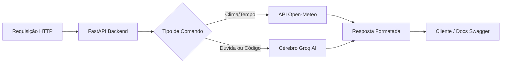

<div align="center">


# SEXTA-FEIRA

**Assistente virtual inteligente em Python, FastAPI e IA.**

Pergunte qualquer coisa, consulte o clima em tempo real e continue trabalhando com uma IA rápida e direta.


[Sobre](#-sobre) • [Funcionalidades](#-funcionalidades) • [Como funciona](#-como-funciona) • [Instalação](#-instalação-e-execução) • [Roadmap](#-roadmap)

</div>

---

## 💡 Sobre

A **SEXTA-FEIRA** é uma assistente virtual com identidade própria, feita do zero em português do Brasil. A ideia é reunir em um só lugar ferramentas úteis para o dia a dia:

- tirar dúvidas sobre qualquer assunto, de contas e código a perguntas aleatórias;
- consultar o clima em tempo real (com integração local para Santos, SP);
- conversar com alta velocidade usando o motor de IA do Groq;
- trabalhar em **segundo plano** enquanto você faz outra coisa.

Depois das funções principais de API, o projeto ganha uma interface web e suporte progressivo para mobile.

> 🛠️ **Projeto em desenvolvimento ativo.** Os itens da seção [Funcionalidades](#-funcionalidades) e do [Roadmap](#-roadmap) mostram o que já existe e o que ainda está planejado.

---

## 🚀 Funcionalidades

| | Funcionalidade | O que faz | Status |
|---|---|---|---|
| 🧠 | **Conversa e dúvidas** | Responde perguntas gerais e ajuda com código via Groq | ✅ Em uso |
| 🌤️ | **Clima em tempo real** | Consulta temperatura e ventos atuais (ex: Santos, SP) via Open-Meteo | ✅ Em uso |
| 🌐 | **Pesquisa na web** | Busca informações atuais e entrega um resumo | 🔜 Planejado |
| 🎙️ | **Voz** | Fala as respostas e ouve você, com palavra de ativação | 🔜 Planejado |
| 🖥️ | **Controle do PC** | Repouso, bloqueio de tela, abrir programas, volume | 🔜 Planejado |
| 📱 | **Interface & App** | Versão web interativa e PWA para dispositivos | 🔜 Planejado |

---

## 🔄 Como funciona



1. **Requisição:** o usuário envia um comando via API (`/chat`).
2. **Identificação:** o FastAPI processa se é uma consulta de clima local ou uma pergunta para a IA.
3. **Processamento:** a inteligência do Groq ou a API de clima respondem dinamicamente.
4. **Retorno:** a SEXTA-FEIRA entrega a resposta estruturada em JSON para a interface ou testes.

---

## 📁 Estrutura do projeto

```
SEXTA-FEIRA/
├── assets/
│   └── logo.png            # Logo do projeto
├── backend/                
│   ├── main.py             # Servidor principal (FastAPI + Groq + Open-Meteo)
│   └── requirements.txt    # Dependências Python
├── frontend/               # Interface web (planejado)
├── .env                    # Variáveis de ambiente e chaves secretas (ignorado pelo Git)
├── .gitignore              # Arquivos protegidos
└── README.md               # Esta documentação

```

---

## 🛠️ Tecnologias

| Tecnologia | Função | Status |
| --- | --- | --- |
| **Python** | Linguagem principal do backend | ✅ Em uso |
| **FastAPI** | Framework web de alta performance | ✅ Em uso |
| **Uvicorn** | Servidor ASGI para rodar a API | ✅ Em uso |
| **Groq API** | Cérebro de IA ultrarrápido | ✅ Em uso |
| **Open-Meteo** | Dados de clima em tempo real | ✅ Em uso |
| **Git e GitHub** | Versionamento e portfólio | ✅ Em uso |

---

## ⚙️ Instalação e execução

> Pré-requisitos: [Python](https://www.python.org/downloads/) instalado e [Git](https://git-scm.com/downloads).

**1. Clone o repositório**

```bash
git clone [https://github.com/matheussaf/SEXTA-FEIRA.git](https://github.com/matheussaf/SEXTA-FEIRA.git)
cd SEXTA-FEIRA

```

**2. Instale as dependências**

```powershell
pip install fastapi uvicorn requests python-dotenv groq --system
# Ou utilizando o uv:
uv pip install fastapi uvicorn requests python-dotenv groq --system

```

**3. Configure suas chaves no arquivo `.env**`

Na raiz do projeto, crie um arquivo `.env` com a sua chave do Groq:

```env
GROQ_API_KEY="sua_chave_gsk_aqui"

```

**4. Execute o servidor**

```powershell
cd backend
uvicorn main:app --reload

```

Acesse a documentação interativa em: `http://127.0.0.1:8000/docs`

---

## 🔒 Segurança e privacidade

* **Chaves de API** ficam estritamente no arquivo `.env`, protegido pelo `.gitignore` contra vazamentos no GitHub.
* **Isolamento de credenciais:** nenhuma chave fica hardcoded no código-fonte.

---

## 🎯 Roadmap

**Fase 1: Backend & IA (Em andamento)**

* [x] Repositório e estrutura inicial (`backend/`)
* [x] Servidor FastAPI configurado com rotas de chat
* [x] Integração com IA via Groq e descoberta dinâmica de modelo
* [x] Rota de clima em tempo real para Santos (Open-Meteo)
* [ ] Módulo de voz (falar e ouvir)
* [ ] Ferramentas de automação e controle local do PC

**Fase 2: Interface & Frontend**

* [ ] Painel web interativo (HTML, CSS e JavaScript)
* [ ] PWA configurado para uso no celular (iOS / Android)

---

## 📝 Autor

**Matheus Ferreira**, estudante de Tecnologia em Inteligência Artificial (Unisanta).

GitHub: [github.com/matheussaf](https://github.com/matheussaf)

```
